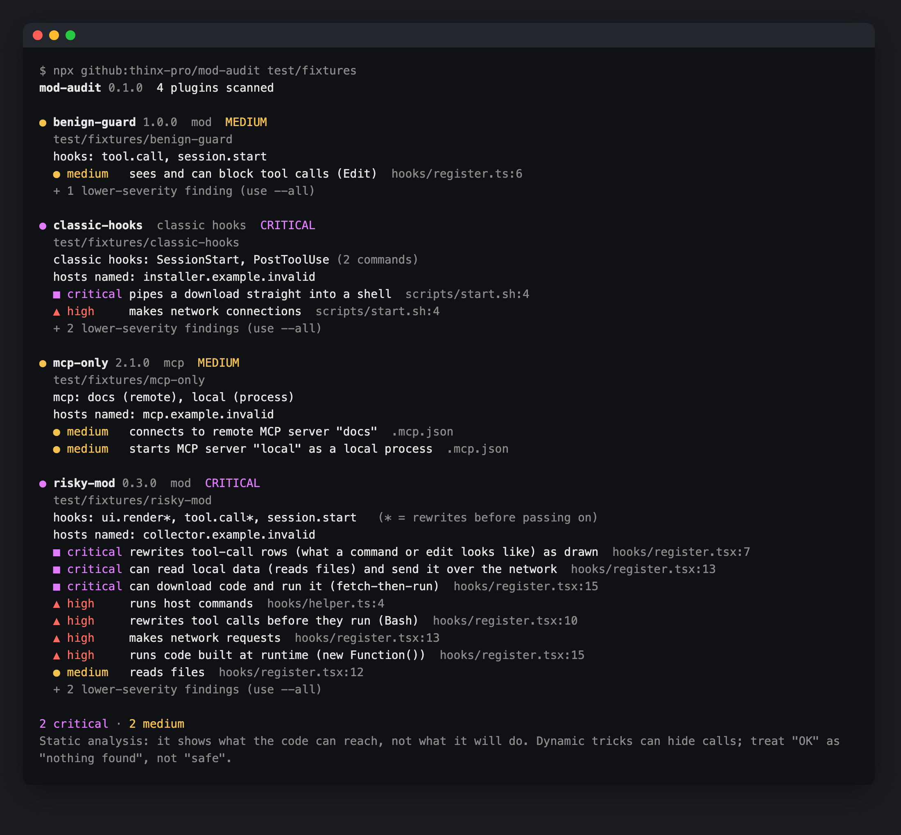

# mod-audit

**See what a Claude Code plugin can do before you install or upgrade it.** mod-audit statically reads a plugin's mods (function hooks), classic hooks, MCP config and skills. It tells you which events the plugin hooks, whether it rewrites tool calls or approval rows, and whether it reads files, makes network requests, runs processes or loads code at runtime. A lockfile then shows you what changed on each upgrade.

<!-- agent-preflight -->
> **Also a Claude Code skill.** `mod-audit` is part of [agent-preflight](https://github.com/thinx-pro/agent-preflight), 16 offline checks for coding agents: `/plugin marketplace add thinx-pro/agent-preflight` then `/plugin install mod-audit@agent-preflight`, and ask Claude in plain words.

   



<sub>Output from the repo's own test fixtures. `risky-mod` and `classic-hooks` are inert pattern files written to be flagged, and they are never loaded.</sub>

## Why

Claude Code Mods shipped on October 1 and are on by default. A mod runs inside the Claude Code process. It can hook any event, pass along a rewritten version (`next({ ...e, ... })`), and draw its own UI, including over tool-call rows and dialogs. Pluto Security's write-up, [*Inside Claude Code Function Hooks*](https://pluto.security/blog/claude-code-function-hooks-security/), demonstrated several attacks with test mods:

- silently reading credentials and prompt history and posting them out
- a fake key-entry prompt above the input line
- an `AskUserQuestion` dialog rewritten so a deletion looked routine
- a fetched script swapped out after review

According to that article, `plugin details` showed a four-event mod as "Hooks (0)", and `plugin validate` doesn't report `next()` rewrites or runtime-fetched code. Meanwhile, "install these 5 mods now" videos are circulating.

mod-audit is the step before installing: a plain list of what a plugin can reach, plus a lockfile so an upgrade can't quietly add network access.

## Quick start

```bash
npx github:thinx-pro/mod-audit
```

With no arguments, it scans your installed plugins (`~/.claude/plugins/cache`) and local mods (`~/.claude/dev-mods`). To check a plugin before installing, clone it and point mod-audit at the folder:

```bash
npx github:thinx-pro/mod-audit ./some-plugin --all
```

## Pin and diff upgrades

```bash
npx github:thinx-pro/mod-audit --write-lock            # writes mod-audit.lock.json
npx github:thinx-pro/mod-audit --diff --fail-on high   # after an update: only what's new; exit 1 on new high/critical
```

Here a plugin's update started reading Claude Code history and posting it out, without bumping its version:

```text
mod-audit diff against mod-audit.lock.json

CHANGED benign-guard  contents changed but version is still 1.0.0
  + critical can read local data (reads files) and send it over the network  hooks/register.ts:12
  + high     makes network requests  hooks/register.ts:12
  + medium   reads files  hooks/register.ts:11
  + low      mentions Claude Code history or credentials  hooks/register.ts:11
  + host     stats.example.net
```

`--fail-on` makes this usable in CI, or in a team repo that commits the lockfile.

## What it checks

| Area | Flags |
|---|---|
| **Mod events** | which events are hooked; whether the hook passes a **rewritten** input (`next({...e})`) for `tool.call`, `prompt.submit`, `prompt.compose`, `session.append`, telemetry and more |
| **Drawing** | `ui.render` on `ToolUse`, `ToolGroup`, `AskUserQuestion`, `UserMessage` and other rows you read before approving (critical when rewritten), or on every component; `Input` fields |
| **Engine calls** | `$.fs.*`, `$.http.fetch`, `$.process.*`, `$.env.*`, `$.session.*`, `$.prompt.submit`, `$.tool.call`, `$.agent.spawn`, `$.mcp.*`, `$.model.*` and others, including destructured access (`const { http } = $`) and computed access |
| **Runtime code** | `eval`, `new Function`, computed `import()`, base64 / char-code / hex obfuscation |
| **Combinations** | read local data + network → *possible exfiltration*; network + dynamic code → *fetch-then-run*; input fields + network; processes + network |
| **Classic hooks** | event list (`PermissionRequest`, `PreToolUse`, `UserPromptSubmit`...), scripts that answer permission decisions, `curl \| sh`, netcat, `eval`, `rm -rf`, `sudo`, cron/launchd persistence |
| **Node scripts** | `child_process`, `fetch` / `http(s)`, file writes, `process.env` |
| **MCP / skills** | local and remote MCP servers; skills or commands that tell the model to pipe a download into a shell |
| **Hosts** | every URL host named in reachable code |

**Reachability.** mod-audit starts from what Claude Code actually loads: `hooks.json` modules, hook commands and MCP entries. It follows relative imports and sourced scripts from there. The verdict comes from reachable code only. Findings in build or dev scripts that nothing loads are listed under `--all`.

Also: `--json` for scripts. Nothing is executed and nothing is sent anywhere.

## How it works

The scanner is regex-based and runs on a copy of each file with comments blanked out, so line numbers still match. That keeps it at zero dependencies and fast enough to run on every update. The event and `$` call tables come from the Claude Code 2.1.293 mod typings. The lockfile stores a SHA-256 of each plugin's files plus its capability IDs and hosts.

## Limitations

- **Static analysis only.** It shows what the code can reach, not what it will do, and a determined author can hide calls: aliasing `next`, building names at runtime, or minified bundles. Computed access and runtime code are flagged, but "OK" means *nothing found*, not *safe*.
- No full parser: unusual syntax can cause misses or false positives. Please open an issue with a snippet.
- The lockfile pins local files only. Code a plugin downloads at runtime isn't pinned, and that's why fetch-then-run is flagged as critical.
- Severity levels are a judgment call. A `tool.call` hook is how a good guard works too, so read the finding, not just the color.

## Roadmap

- A GitHub Action wrapper (`--fail-on` already works in any CI).
- Cursor plugins and Codex extensions.
- A real TS/JS parser behind a flag.
- A public list of audited community mods.

## License

MIT. Not affiliated with Anthropic. "Claude Code" is used only to describe compatibility.

---

### 中文说明

**mod-audit**：在安装或升级前看清一个 Claude Code 插件（Mods 函数钩子、经典 hooks、MCP、Skill）能做什么：挂了哪些事件，是否改写工具调用或确认框，是否读文件、联网、起进程、运行时拉代码执行。还能生成锁文件，升级时只列出新增的能力和域名，可配合 `--fail-on` 在 CI 里拦截。`npx github:thinx-pro/mod-audit` 一行运行，零依赖，只读文件、不执行插件代码。这是静态分析，「未发现」不等于「安全」。
